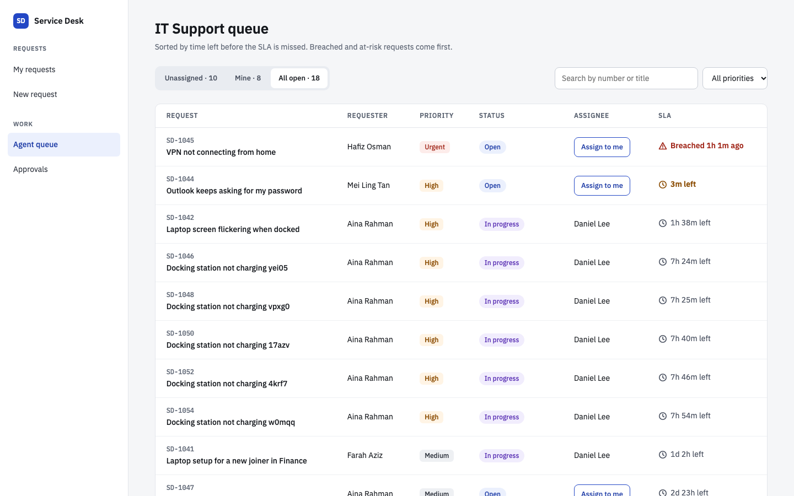
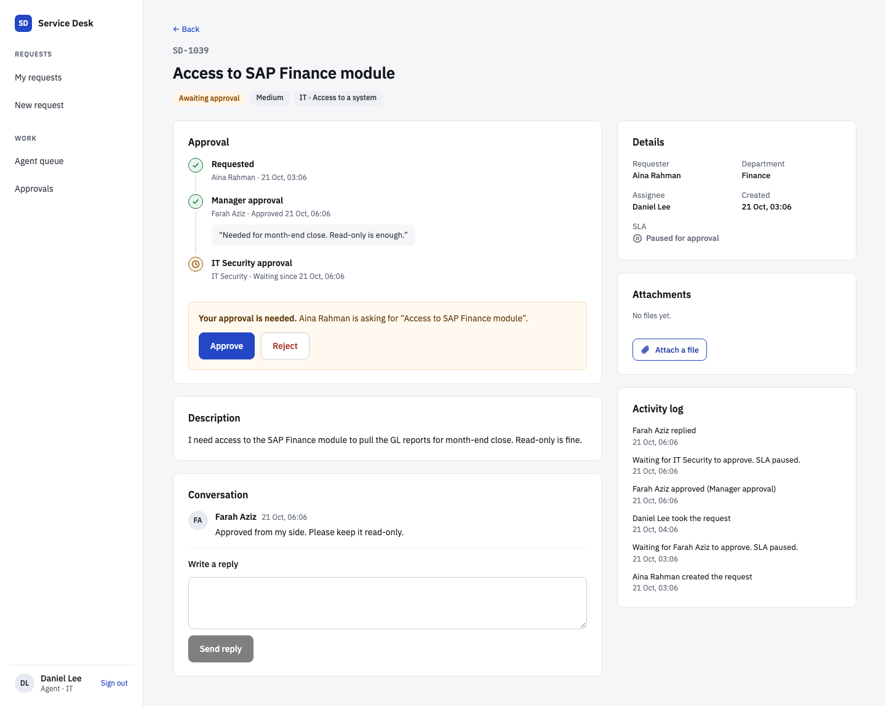
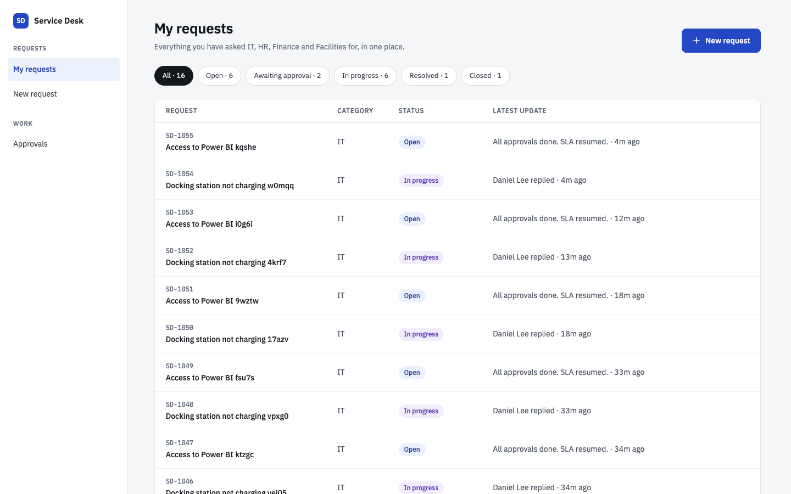
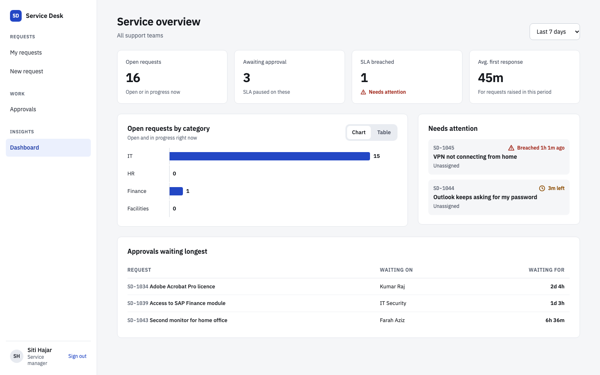
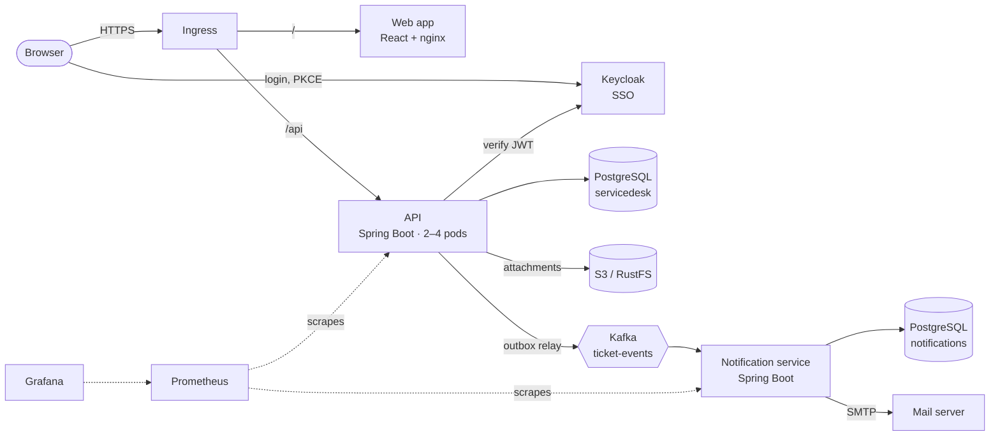
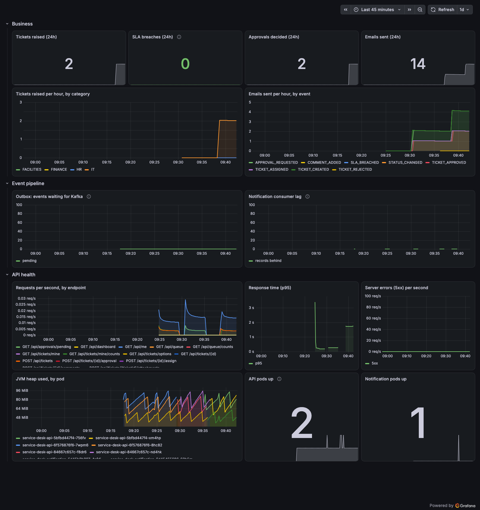

# Service Desk

An internal service desk for a large company. Staff raise requests to IT, HR, Finance
or Facilities. Requests that need sign-off go through an approval chain. Agents work
a queue ordered by SLA, and service managers watch a live dashboard. Every step sends
an email.

Built as a production-style system: four services, single sign-on, an event-driven
backend, a Kubernetes deployment with autoscaling and monitoring, CI/CD, and
infrastructure as code for AWS.

## Demo

One request from start to finish, recorded on the Kubernetes deployment: a staff member
asks for system access, her manager and IT Security approve it, an agent picks it up and
replies, the service manager sees it on the dashboard, and every step sends an email.


[Watch in full quality (MP4, 1 minute)](docs/demo.mp4)

## Screenshots

| Agent queue | Ticket with a two-step approval |
|---|---|
|  |  |

| My requests | Manager dashboard |
|---|---|
|  |  |

## What it does

| Role | Can |
|---|---|
| **Staff** | Raise requests (incident, service request, system access, purchase), attach files, follow progress, reply |
| **Manager** | Approve or reject their team's access requests and purchases over RM 1,000 |
| **IT Security** | Second approval for every access request |
| **Agent** | Work their team's queue: take tickets, reply, resolve, close |
| **Service manager** | See open work, SLA breaches, response times and stuck approvals |

- **SLA per priority** (Urgent 4h, High 8h, Medium 3 days, Low 5 days). The clock
  pauses while a request waits for approval. Tickets turn "at risk" with less than 20%
  of the time left. A breach is escalated to service managers by email.
- **Approval rules in one place.** Access needs the manager and then IT Security.
  Purchases over RM 1,000 need the manager. Nobody can approve their own request, and
  a rejection needs a reason.
- **Audit trail.** Every change is written to the ticket's activity log.
- **Email for every event.** Receipts, approval requests, decisions, replies and escalations.

## Architecture



### Design decisions worth asking about

- **Transactional outbox.** The API never publishes to Kafka inside a request. It saves
  the event in the same database transaction as the change, and a relay publishes it
  afterwards. So an event is never lost when Kafka is down, and never sent for a change
  that rolled back. The relay locks rows with `FOR UPDATE SKIP LOCKED`, so all API
  replicas can relay at the same time without sending duplicates.
- **At-least-once delivery, made safe.** The notification service records every event
  id it handles, so a redelivered event does not email anyone twice. A failing event is
  retried 3 times, then parked on a dead-letter topic so it cannot block the events
  behind it. Malformed messages go to the dead-letter topic straight away.
- **Events carry their own data** (names, emails), so consumers never call back into the API.
- **Business rules live in the domain model.** `Ticket` owns its status transitions and
  SLA maths, and `ApprovalPolicy` owns who must approve what. They hold no matter which
  endpoint or job changes a ticket, and they are unit-tested without Spring.
- **Security.** OAuth 2.0 / OIDC with Keycloak: the web app uses Authorization Code +
  PKCE, and the API checks the signature, issuer, expiry and audience of every JWT.
  Roles come from the token. Anyone outside a ticket gets **404, not 403**, so they
  cannot tell it exists. Optimistic locking stops two agents silently overwriting each
  other. Attachments are type-checked, renamed in storage and always served as downloads.
- **No stored cloud credentials.** On AWS the API reaches S3 through EKS Pod Identity,
  and GitHub Actions deploys through OIDC federation. No access key exists anywhere.
- **One database per service**, with Flyway migrations; Hibernate only validates the schema.

## Tech stack

| Area | Choice |
|---|---|
| Backend | Java 21, Spring Boot 4.1 (Web MVC, Data JPA, Security, Kafka), Flyway |
| Data | PostgreSQL 16, Kafka 4.3 (KRaft), S3 (RustFS locally) |
| Identity | Keycloak 26, OAuth 2.0 / OpenID Connect |
| Frontend | React 19, TypeScript, Vite 8, React Router, TanStack Query |
| Testing | JUnit 5, AssertJ, MockMvc, Testcontainers, Vitest, Testing Library, Playwright |
| Delivery | Docker (multi-stage, non-root), Helm, Kubernetes (HPA, PDB, probes), GitHub Actions |
| Monitoring | Micrometer, Prometheus, Grafana |
| Cloud | Terraform: AWS VPC, EKS Auto Mode, RDS, S3, ECR, IAM (Pod Identity, GitHub OIDC) |

## Tests

| Suite | What it covers |
|---|---|
| `api` — 62 tests | Domain rules (SLA, status, approvals), every endpoint against real PostgreSQL, the outbox relay against real Kafka, S3 storage against RustFS |
| `notification-service` — 11 tests | Email rules, Kafka → email end to end, duplicate events, dead-letter topic |
| `frontend` — 11 unit tests | Formatting, SLA indicator, chart accessibility (labels, keyboard, table view) |
| `frontend` — 3 end-to-end tests | Real browser through Keycloak login: raise → assign → reply; two-step approval; role-based menus and dashboard |

CI runs all of them on every push, including the end-to-end tests against the full stack.

## Run it

### On your machine (for development)

Needs Docker, Java 21 and Node 22.12+.

```bash
docker compose up -d                                  # Postgres, Keycloak, Kafka, Mailpit, RustFS
(cd api && ./mvnw spring-boot:run)                    # http://localhost:8080
(cd notification-service && ./mvnw spring-boot:run)   # http://localhost:8081
(cd frontend && npm install && npm run dev)           # http://localhost:5173
```

Sign in as any demo user with the password `password`:
`aina` (staff), `farah` (her manager), `daniel` (IT agent + IT Security approver),
`mei` (HR agent), `siti` (service manager). Emails appear at http://localhost:8025.

### On Kubernetes (Rancher Desktop, Docker Desktop, kind)

```bash
for s in api notification-service frontend; do docker build -t service-desk/$s:0.1.4 $s; done
helm upgrade --install service-desk deploy/helm/service-desk -n service-desk --create-namespace
```

Then open http://servicedesk.localhost (mailbox: http://mail.servicedesk.localhost).
Monitoring is optional:

```bash
helm upgrade --install prometheus prometheus-community/prometheus --version 29.37.1 \
  -n monitoring --create-namespace -f deploy/monitoring/prometheus-values.yaml
helm upgrade --install grafana grafana-community/grafana --version 14.0.1 -n monitoring \
  -f deploy/monitoring/grafana-values.yaml \
  --set-file dashboards.default.service-desk.json=deploy/monitoring/service-desk-dashboard.json
```

Grafana: http://grafana.servicedesk.localhost



### On AWS

See [deploy/terraform/aws/README.md](deploy/terraform/aws/README.md). Terraform builds
the network, an EKS Auto Mode cluster, RDS, the S3 bucket, image registries and the
GitHub deploy role. The **Deploy to AWS** workflow then builds the images and installs
the Helm chart with [values-aws.yaml](deploy/helm/service-desk/values-aws.yaml).

## Repository layout

```
api/                    Spring Boot API: tickets, approvals, SLA, attachments, dashboard
notification-service/   Spring Boot Kafka consumer that sends emails
frontend/               React web app, unit tests, Playwright end-to-end tests
deploy/helm/            Helm chart (apps + optional in-cluster infrastructure)
deploy/monitoring/      Prometheus and Grafana settings, dashboard
deploy/terraform/aws/   AWS infrastructure
deploy/aws/             One-time EKS cluster setup
.github/workflows/      CI and AWS deployment
compose.yaml            Local infrastructure for development
```

## Not done yet

- AI help (category suggestions, reply drafts, ticket summaries)
- A Content Security Policy for the web app, and a backend-for-frontend so tokens never
  reach the browser
- Alerting rules (Prometheus Alertmanager) on SLA breaches and outbox backlog
